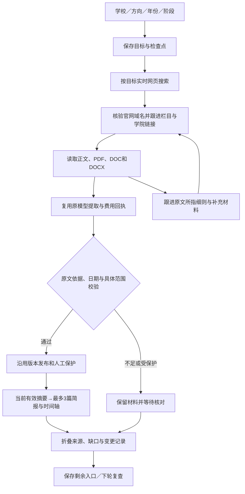

# 个性化升学简报与后台Agent

2026-10-19。开发分支 `codex/admission-agent`，依赖已推送的升学模块和本机尚未提交的准备工作台。本文描述实际实现；公网仍运行原用户来源版，本轮没有部署、提交或推送。

## 简报改版验收（2026-10-19，当前版本）

本机5470已运行简报版；清华任务9988d54a-f757-45c5-9a57-abc896d4878a和北航任务b2f8e4c5-ff89-4554-b942-4231d52b0a5d均读回真实独立库，官网材料已保存，模型关闭、简报等待整理，费用与请求尝试均0。没有把测试报告写进真实库。

类型／Web构建、251独立测试、Agent端到端3项、简报网页专项、站点smoke30通过；隔离后端完整933／933。网页首轮63／65，两项行业导航用例失败；保持原断言串行完整复验65／65通过（107.7秒），最终退出码0。下文较早的921／925等数字仅记录对应先前轮次，不代替本次结果。

专项覆盖学校名／链接解析及歧义／伪域拒绝、全校与专业范围、保研／考研实际抓取提取发布、人工与机器引用状态、撤回同步、精确截止／北京时间跨日／未知日期／未来发布日期、3篇上限与重复去除。浏览器覆盖默认隐藏过程、学校名与链接提交、保研考研切换、空专业、报告与时间轴联动、原文链接、恢复与损坏清单；1440／768／390／375无横溢或页面错误。已查看真实等待态与合成完成态的桌面手机深浅截图；完成态是明确标注的交互测试材料，不是真实招生报告。

首轮检查修复：类型检查检出日期辅助函数递归替换错误；选择框补显式可访问标签；端到端检出verified实际表示人工核验，改为同时接受已发布且有引用核对记录的machine结果并分别标注，未放宽原有证据发布链路。

## 前期本机真实运行记录（10月19日，改版前）

真实入口改为 `http://127.0.0.1:5470/admissions/agent`，API在5471；原5469仅为静态交互演示，不会创建数据库任务。真实页面标注模型关闭，新材料等待整理；运行说明中的本机费用不代表线上账目。

专用启动器为 `modules/admission/scripts/local-agent.ts`，使用Node24及已构建的Web；通过 `node --env-file=<本机私有配置> modules/admission/scripts/local-agent.ts` 启动。私有配置仅需 `DATABASE_URL`，库名必须是独立的 `allnews_agent_local`，主机必须为回环地址；启动器拒绝其他库名，执行正常迁移，运行真实API、Web和仅 `admission.agent` 的队列。它强制关闭模型、推送及API端采集，不运行新闻、旧来源导入或其他模块worker，不提供开发免登录后台。

当前数据库是服务器上的独立新库，用独立受限账号访问，经SSH隧道映射到本机55432；没有复制或修改生产公告、累计费用或业务库。数据库连接保存在本机 `.data/agent-review/local.env`，不入Git。重启需先保持SSH隧道可用（`ssh -N -L 127.0.0.1:55432:127.0.0.1:5432 root@1.92.71.135`，使用已核对的主机记录及本机认证），再运行启动器；停止启动器不会删除任务和材料。

创建成功后立即显示确认、将真实任务ID写入恢复链接；相同目标会明确提示复用已有任务，已暂停目标不会因重复点击自动重试。模型关闭或预算不足后，立即持久化暂停状态和剩余官方入口，不再保持“排队”继续读到页面上限；预算暂停与范围上限分别说明。

本轮浏览器真实验收：清华官方具体公告读取成功，1页／1候选／6条持久日志，4个待查入口保留，状态等待启用模型；未发布机器猜测的条件。本机费用预留、模型回执及请求尝试均0，桌面1440和手机390无横溢或页面异常，刷新恢复及相同目标复用通过。验证记录与截图在 `.data/agent-review/local-*`。当前没有启用真实模型；线上约4.961002／5元账目保持原状。

本轮最终验证：本机类型、Web构建、240独立测试、Agent网页专项和30项站点smoke通过；Linux隔离后端921／921、Web65／65通过。Windows全量网页53／65，12项为此前已有的浏览器启动spawn UNKNOWN，Linux完整复验未复现。预算暂停新断言确认只读1页就显示暂停并保留入口；已有成功缓存则无需模型继续复用，首轮新测试将缓存误判为应暂停（920／921）后恢复原顺序断言，专项2／2及完整921／921重跑通过。启动器拒绝三类错误数据库配置的检查通过；最后读回真实任务HTTP200、等待模型、6步骤、费用0。

GitHub API核对远端main仍为 `89ca54386637b96e6453f598794485d0fd08d523`，是当前分支祖先；直接Git fetch网络重置，API核验不冒充fetch成功。本轮新增代码限制在升学模块及其专项测试，未改包锁、共享配置或历史迁移；原先未提交的工作台与Agent成果保留。后续PR仍需在提交前重新检查main，当前未提交、推送、合并或切换公网服务。

## 使用方式

打开 `/admissions/agent`，输入学校名称或该校官网链接，选择保研／考研；专业方向选填，留空关注全校。年份与阶段、是否联网搜索收在“年份与查找范围”。输入先在已核验院校目录中解析：名称支持唯一匹配，存在多个校区或同名候选时要求明确；链接按官网根域匹配，不信任相似域名。当前目录116个办学条目、含39所985，不能视为已导入另行提供的936单位表，也不能视为所有学院已覆盖。

默认展示一份简报，其他已保存简报折叠选择。简报最多3篇要点，包含摘要节选、申请重点、下一步与编号官方原文链接；完整条件和材料仍可打开详情。按未过期且7天内截止、近14天发布、其他未明确截止／尚未截止、已截止回顾排序；未来发布日期不算近期。近截止只是优先核对提示，不保证当前开放申请。

申请时间轴只使用原文明确的开始／截止日期，按北京时间判断精确截止时刻；只写日期的公告当天不臆定具体截止时刻。缺日期明确提示，不画推测节点。点击日期突出显示对应要点；历史日期标明已过，不把两个端点之间视为持续报名期。查找线索、缺口、页数、执行记录默认折叠到“来源与处理记录”。

简报在模块公开读取层组合当前公开摘要，不新增跨文模型写作调用，刷新不触发搜索、采集或模型调用。仅接受人工核验来源，或经过引用核对且已发布的机器提取结果；机器结果仍明确标注未经人工复核。撤回内容立即从简报消失。指定专业时，校级和其他专业仅作折叠参考；全校模式则允许符合年份和阶段的校级通知。搜索结果不能直接成为摘要，没有结果时显示等待／空状态，不能据此认定学校没有发布。当前模型关闭，真实新材料只能查找与保存，不能据此宣称已完成真实报告生成。

默认勾选联网搜索，已有来源和学校官网作为补充入口；取消勾选只沿已有入口查找。保研支持夏令营／预推免／正式推免，考研支持统考／简章／复试／调剂。旧任务缺少track仍按保研运行，旧任务也不会自动开启联网搜索；如需新范围应创建新简报。

### 联网发现（10月19日）

使用360网页搜索，无需Key或付费搜索接口。按学校、方向、入学年份和阶段生成2条搜索词；同时关注夏令营时最多3条。夏令营按入学前一年检索。每条最多检查前10项，不保证搜索引擎完整收录。只接纳已观察到的本校官网地址，允许目录官网根域名下的新学院子域名；不会根据搜索标题自动信任新根域名。名单、公示、旧年份和仅涉及本校推荐资格的结果过滤，搜索摘要不作为条件证据。

搜索词、结果数、接纳数、官网链接和成功／失败状态存入任务检查点。相同一轮恢复不会重新发送已完成搜索；发送后中断则标记失败，下一轮才重新查找。搜索超时、验证码或结构变化明确显示覆盖不完整，并继续已有官网入口；不会把空白错误页当成“未发布”。页面刷新不执行搜索。当前只有一个搜索提供方，受服务可访问性、索引时效和网页结构影响；不是无限制全网爬取或穷尽检索。

本机真实北航目标：`http://127.0.0.1:5470/admissions/agent?task=b2f8e4c5-ff89-4554-b942-4231d52b0a5d`。2次搜索共去重保留5条官网线索，成功读取计算机学院2027年接收推荐免试工作方案（`https://scse.buaa.edu.cn/info/1299/12507.htm`）；2页／1候选／12条步骤，模型关闭而等待提取。部分附件未解析会单列缺口。不能将发现5条线索说成已整理5条要求。独立库模型费用及尝试为0；线上累计预算不变。

清华计算机方向真实搜索读取6项，接纳计算机系与软件学院2条官方线索；计算机系原文`https://www.cs.tsinghua.edu.cn/info/1048/7259.htm`返回200并有正文，软件学院只计相关参考，未冒充计算机专业覆盖。上述样本仅验证发现与读取，不是模型准确率评测。

点击创建后只保存排队目标，后台执行后才显示实际步骤。页面刷新只读取状态，不触发抓取或模型调用。同一个规范目标复用任务；任务ID清单仅保存在当前浏览器，恢复链接可以另存或分享。损坏的本机记录不覆盖，无法存储时提示另存链接。共享任务的暂停、恢复和重试由管理员操作。

页面分别显示已检查页面、候选材料、已处理候选、匹配要求、剩余入口和读取失败数。校级参考与具体方向结果分开，预算暂停、等待模型、证据不足和读取失败分开显示。执行记录来自后台持久日志，不展示虚构思考过程。

## 执行链路

这是确定性工作流规划器配合实时网页搜索及既有LLM语义提取。规划器按目标关键词、保研／考研主题、院系导航、分页和原文补充线索排序；模型不直接控制HTTP、数据库、权限或预算。候选正文中的细则、申请表等链接可进入最多两层补充跟进；缺少匹配方向、日期、条件或材料时显示缺口。不具备自由浏览器操作或保证补齐缺口的能力。

只跟进页面里实际出现的链接，也支持 `onclick` 中明确的静态地址和官方重定向包装，不执行脚本。标题没有年份的接收办法仍可成为候选，最终入学年份依赖正文及原有证据校验。名单、公示、会议、博士专栏和国际招生等明显无关入口过滤；导航仍可能带来需进一步判断的硕士考试页面，不能用候选数作为准确率。

每目标每轮最多20个主页面／独立文件，导航深度3，每篇最多3份附件，最多两层补充跟进，待查队列100条。每次worker处理最多2页，并在步骤边界检查180秒时限；它不是整轮的严格总时长或对进行中模型调用的强制中止。已有HTTP超时、文件大小、解析和模型边界继续有效。达到范围上限时显示部分完成并保留剩余入口，下轮优先处理剩余入口，避免旧首页挤占后续学院。

`admission.agent` 队列并发1。每分钟调度到期任务，分段任务约一分钟后继续；结束后约一小时复查。额度不足、模型未启用和等待人工核对的任务不会由定时器自动重复提取，需要管理员检查后恢复。原有 `admission.import` 来源任务继续保留；两者共享材料、回执和累计预算。

## 数据、证据与恢复

只接受目录内该校官方域名的公开URL；提交拒绝特殊端口、URL凭据和敏感参数，读取复用DNS、私网地址和重定向防护。网页与附件均视为数据，不能改变系统权限。每小时最多20个新目标，全站最多200个，浏览器最多保存20个任务ID。当前没有用户账号、私有任务或云端清单同步。

材料按内容哈希保存。正文或附件变化会生成新快照，未变内容复用原结果；Agent复用旧结果时也重新校验具体院系、专业与批次的引用支持。模型费用继续经过原Provider回执与固定累计批次，不能换任务ID清账。发布、文档处理完成标记与回执完成在同一事务中提交，避免进程中断后重复发布。

抓取后、提取前保存检查点。重启和预算恢复优先处理已存快照，无需重新下载；超过本次两页处理量的材料继续排队。材料快照缺失会记录读取失败，不能凭空补要求。空白页、受限页面和处理失败保留旧公开版本；人工更正或撤回继续受到原发布链路保护。目标只关联本轮成功处理的材料，再读取其当前公开版本，不恢复已撤回内容。后续来源任务或人工编辑可能更新同一公告，详情以当前有效版本为准。

具体专业匹配同时要求学校、入学年份、保研／考研路径、关注阶段和院系／专业关键词符合；校级通知与范围不明确的目录不算专业覆盖。机器整理仍标注未经人工复核，不构成资格判断或录取承诺。

用户原累计上限5元，原保守记账约4.961002元，已明确不追加。本轮只用隔离数据库和本地假模型验证，没有新增真实付费请求、修改生产费用、切换模型或重置批次。真实院系端到端整理仍需可用额度与可读原文；这次官网结构样本验证不能替代真实提取验收。

## 文件与接口

| 内容 | 位置 |
| --- | --- |
| 简报组合与学校名／链接解析 | `modules/admission/backend/agent-brief.ts`、`goal-input.ts` |
| 简报正文与时间轴 | `modules/admission/web/agent-report.tsx` |
| 目标与公开状态契约 | `packages/contracts/src/admission-agent.ts` |
| 链接规划、范围匹配、缺口 | `modules/admission/backend/agent-planner.ts` |
| 实时搜索与官网线索筛选 | `modules/admission/backend/agent-search.ts` |
| 持久执行、恢复、管理命令 | `modules/admission/backend/agent.ts` |
| 模块公开读取 | `modules/admission/backend/publication.ts` |
| 工作流与管理页面 | `modules/admission/web/agent.tsx`、`admin-agent.tsx` |
| 任务与步骤表 | `0080_admission_agent_tasks.sql`、`0081_admission_agent_steps.sql` |

公开JSON：`POST /api/v1/admissions/agents` 创建目标；`GET /api/v1/admissions/agents?ids=UUID,...` 读取最多20个任务，经过模块publication注册。管理员页面 `/admin/admissions/agents`，对应受保护的GET与 `POST /api/admin/admissions/agents/:taskId`，动作 `pause`、`resume`、`retry`，均留审计。运行中目标持锁，管理操作返回冲突，结束步骤后重试。

## 验证与当前限制

隔离数据库测试覆盖实际队列→栏目→学院→通知→真实生成的DOCX附件→补充细则→带证据发布；同时验证重复目标、同源限制、私网／外域拒绝、分页循环、范围隔离、未变不调用、同URL变更、预算暂停、关模型、404、管理员暂停与断点恢复。合成材料与假模型不计为真实招生数据。

官网只读抽样4所：清华、北京理工、吉林和中科大，均读取成功，保存HTML后比较旧栏目读取与新规划输出。旧“当年公告候选”分别4／6／3／12，新“导航与候选链接”分别9／18／9／19；两种数量口径不同，不能据此宣称覆盖率提高。人工检查确认新增院系入口、有限分页和中科大静态onclick入口，并据会议等噪声收紧过滤。没有重新爬完39校，也没有做真实模型准确率测评。

浏览器验证目标提交、只读轮询、真实步骤为空时的等待状态、预算暂停、恢复链接、损坏存储及存储拒绝；1440／768／390／375四种宽度无横向溢出，桌面与手机深浅主题已看图。旧5469为合成界面演示，当前5470已连接真实独立数据库和官方读取；两者均不是公网部署结果。

最终代码在服务器独立测试目录验证，生产服务和业务库未更改：

| 检查 | 结果 |
| --- | --- |
| 完整类型检查 | 通过 |
| 完整后端 `npm test` | 联网搜索后925／925 |
| 独立测试 `npm run test:standalone` | 联网搜索后243／243；部分也包含于后端套件，不累加为唯一用例数 |
| 生产Web构建 | 通过 |
| 完整Web浏览器／HTTP测试 | 65／65 |
| `scripts/smoke.ts` | 30／30 |
| 新页面与接口真实联调 | 隔离Web＋API＋PostgreSQL；创建目标202、读取排队与零步骤、费用0、管理员未登录401 |
| 差异与秘密模式检查 | `git diff --check`通过；变更文件未发现Key／带密码数据库URL模式 |

联网搜索新增离线验证：新学院结果进入实际读取／保存，搜索失败仍读取已有入口，同轮恢复不重复搜索、中断状态明确，旧目标不隐式联网，公开读取不触发搜索，模型关闭时费用不变。网页验证默认勾选／取消提交及搜索结果展示；真实北航任务1440／390截图无横向溢出或页面异常。完整Web65／65、类型、构建、站点smoke30／30最终通过。本轮仍未提交或部署。

首轮测试副本遗漏工作区嵌套依赖，类型检查错误来自undici7代替锁定8；补齐后最终完整复验通过，没有修改无关代理代码。冒烟脚本首轮同步运行子检查阻塞了同进程测试API，导致503；改为异步运行后30项及新接口联调通过，没有放宽断言。

验证日志留在本机 `.data/agent-review/` 与服务器隔离目录 `/tmp/all-news-agent-review/.data/`，不纳入Git；本地浅色四屏宽及深色桌面／手机截图也在该目录。动态栏目、验证码、扫描件、复杂目录和未明确条件仍可能无法解析；不绕过访问限制，不把无法读取的学校算作已完成。

## 追加5元真实模型试跑（2026-10-19）

用户明确追加5元。保留生产固定批次原账4.961002元及原5元熔断；在`allnews_agent_local`独立库使用另一固定5元额度，不清账或重置旧批次，两库总授权最多10元。当前追加保守记账0.317860元（16条额度登记，包含校验失败和修复），两库合计5.278862元。金额按token及失败保留额估算，不能代替DeepSeek账户账单。

服务器隔离副本通过官方`api.deepseek.com`的`deepseek-flash`执行单目标临时进程，未恢复常驻付费队列。最终回执16为completed，有真实响应；15为收到但未通过校验的前次答案，保留供追溯。临时付费进程已退出，常驻本机worker仍关闭模型；新任务不会自动使用剩余额度，查看和刷新不会调用模型。

真实报告：`http://127.0.0.1:5470/admissions/agent?task=b2979816-921b-4138-89c4-1e8184c7dc50`。官方来源为北京大学信息工程学院《2027年接收推荐免试研究生说明》：`https://www.ece.pku.edu.cn/info/1025/3213.htm`。适用深圳研究生院的集成电路科学与工程、计算机科学与技术硕士申请，不能外推本部计算机学院。网报2026-09-08 10:00截止、电子材料同日12:00截止、纸质材料09-10前寄达；报告明确已截止，仅供政策回顾。原文年份、专业、英语多选一及作者限制、三个材料节点均已对照；仍显示机器引用核对、未经正式人工核验。

真实试跑修复：接收“说明／指南”候选；排除本校推免资格推荐和仅直博材料，并在自动发布层再次拦截；保留混合硕博通知中的硕士部分。提示词禁止跨硕博段拼专业、将推免复试误分类为考研复试；无明确学位类型依据时降为unknown，避免把“某专业硕士研究生”误判成专硕。更新提示词后单篇显式重处理复用已保存快照，仍经预算、回执、引用及人工保护，不篡改模型答案冒充成功。旧误分类通知通过版本与审计撤回；清除成功后的旧“尚未找到”缺口。本机说明改为区分已完成真实报告与新任务未自动启用。

本轮最终验证：完整类型检查、Web构建、独立255／255、Linux完整后端937／937（直接Node进程退出0）、完整Web65／65、站点smoke30／30及隔离HTTP联调通过。早期Web两项行业导航失败，最终保持原断言完整重跑通过；早期后端npm包装进程非0但断言全过，改用直接Node执行完整套件确认退出0，未调整业务断言。本机smoke最初使用旧测试库时权限不足，改用明确独立测试库并指定测试账号为库所有者后通过，未扩大账号集群权限。

本机数据库隧道曾断开，已恢复回环55432；API／Web／专用worker已载入新版。1440浅色、390深色实际报告已查看，时间轴点选联动、原文链接和恢复链接通过；刷新后预算仍0.317860。截图及真实响应保存在忽略目录`.data/agent-review/trial-real-*.png`与`public-real-result.json`。本轮检查20页但不是20份要求；部分附件不可读、达到页面上限及其他通知待核对仍显式保留。没有做真实模型准确率测评，也没有启用全校批量付费、提交推送或公网部署。

## 部署与回退

本轮未发布。后续部署前停止专用升学worker，备份业务库，应用0080／0081新迁移并构建新release，再切换API／Web和专用worker；API／Web采集与模型阀仍关闭，只有worker按已批准配置运行。无需新环境变量或模型接口，也不删除原来源队列、历史公告、材料、费用或审计。生产模型额度不足时应保持暂停，不因部署自动恢复旧失败提取。

回退先停止新worker，再切回旧release并重启API／Web；新表保留，不执行破坏性回滚。新队列的未完成任务保留且不运行，后续升级可恢复；不要用恢复数据库备份覆盖升级后其他业务新增数据。Git提交、推送与公网部署在本次成果审查后另行授权。
