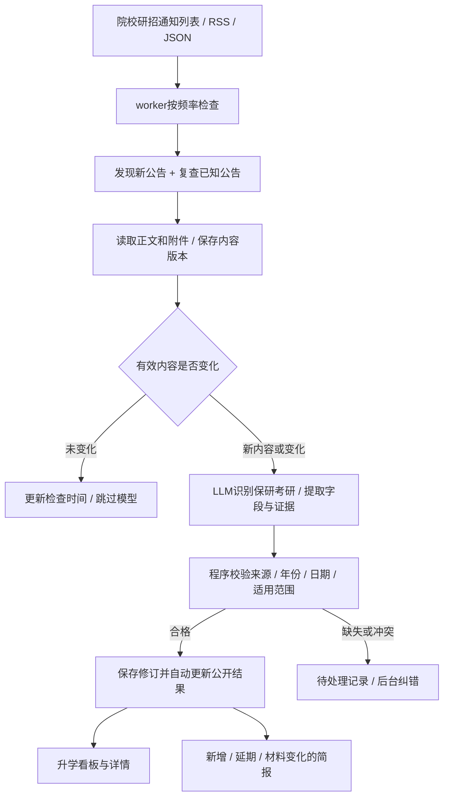

# 升学板块自动更新：架构复核与方向修正

2026-10-17。用户指出当前实现偏离项目自动采集与模型处理主线，先复核架构并确定方向，随后已按用户授权实施。本文保留设计推导，当前部署与范围以自动更新预览及覆盖记录为准。

## 复核结论

升学板块应是持续更新的招生信息服务：配置院校信源和模型后，由 worker 定期发现公告、读取正文及附件、提取事实、识别变更，并更新看板和生成升学简报。人工工作集中在信源维护、异常处理与纠错。

之前实现了学校目录、详情、筛选、收藏及人工发布，但没有接入自动采集和模型任务。这些页面可保留作为自动化结果的展示端，人工发布流程保留作异常处理入口；主线应转向自动更新闭环。

最初架构复核时正式公告为0条、示例4条；后续实施已发布39校真实公告。本轮官网调查材料保存在被忽略的 `.data/admission-research/`，没有导入数据库、部署新代码或启动付费任务。

## 已实际阅读的依据

- 上游 [AIHOT](https://github.com/KKKKhazix/AIHOT)，本次读取 main 提交 `84a7abb1d00a43a41e3ddcc26c45e1a23785e075` 的 README、信源／架构文档和采集、模块、报告代码。GitHub网页读取超时后，使用 GitHub API 获取固定提交文件；没有将上游覆盖进本地项目。
- 本地 `packages/backend/src/sources/`、`content/materials.ts`：多种信源、日期与首次回灌规则、去重、材料修订、失败健康状态。
- 本地 `providers/llm.ts`、`providers/receipts.ts`、`providers/section-money.ts`：OpenAI兼容接口、回执、请求上限和可配置费用限制。
- 本地 `modules.ts`、`apps/worker/src/main.ts`、`site/modules/server.ts`：模块可注册队列、定时任务、模型步骤及公开读取。
- 本地 `modules/world-news/`：已接入采集、分析、归组、摘要公开与自动日报；不能把历史其他部署的启用记录当成本次服务器已经启用。
- 本地 `modules/competition/backend/`：已有HTML／PDF／Word解析、材料快照、带证据提取、原文变化跳过／修订及有界补查能力。
- 架构复核时的 `modules/admission/server.ts` 只有HTTP及公开读取，没有队列、定时器、模型步骤。`WORKER_MODULES` 只安装 world-news，预览服务器也未启动worker。

上游日报主要按规则编排既有结果；周报／月报再由模型写总述和栏目导读。不能把每次更新都描述成重新调用模型写整篇报告。

## 推荐实现

| 能力 | 复用基础 | 升学需要补的部分 |
| --- | --- | --- |
| 信源接入 | RSS／网页选择器／JSON读取器、抓取健康状态 | 学校与院系归属、类别、具体列表入口、试抓结果 |
| 定期执行 | pg-boss、模块队列、定时器、运行记录 | 升学采集与处理任务，并注册到worker |
| 正文与附件 | 既有安全HTTP读取、竞赛材料解析 | 把实际共用的解析能力提取为中性工具，避免升学依赖竞赛业务 |
| 模型处理 | `chatJson`、模型配置、回执与预算 | 升学提示词、严格字段契约、逐字段证据和未知状态 |
| 变更检测 | 材料hash、修订与审计思路 | 同URL正文／附件复查，以及独立延期公告与原机会的关联 |
| 对外展示 | 当前升学页面、publication入口 | 自动任务的发布身份、自动核验状态、版本变更说明 |
| 简报 | 日报编排与周期报告思路 | 升学数据适配；按新增／变更／临近截止组织，而非照搬AI新闻热度 |

推荐保留独立升学模块，接入现有引擎的任务、采集工具和模型基础设施。现有新闻section契约只接受 `ai`／`world`，世界分析流程还明确只用列表文字；不能把升学ID直接传入或只改提示词就声称完成。新闻报告也依赖新闻／事件结构，需要适配升学对象。

不整站替换 `industry/` 的AI规则，避免破坏已有资讯板块。也不直接复制竞赛的预算包装器：其中绑定了竞赛任务身份、模型及验收口径；应共用底层能力，保留各领域规则。

## 升学需要特别处理的规则

- 招生年度与发布时间分开；学校、院系、专业、阶段和批次构成对象范围，校级要求不覆盖院系特例。
- 公告列表出现新链接与原公告内容变化分别检测。首次回灌的旧公告可进入对应年份资料库，但不作为今日新发布消息；不能直接沿用新闻48小时规则排除仍有效的招生公告。
- 模型输出必须能对应到已读取的正文／附件证据；附件失败是读取失败，不能写成“官方未要求”。缺失日期保持未知。
- 现有 `source.verified` 表示人工核验，自动任务不能伪造人工确认。实施时需区分机器校验、人工核验、冲突待处理，并同步发布校验与界面文案。
- 符合已验证规则的材料自动更新；冲突、身份不明或材料不足时进入异常队列，避免日常更新依赖逐条手录。明确人工撤回的内容不能被下次任务自动恢复。
- 新公告关联到哪条既有机会，需要范围和原文证据；只按相似标题合并可能误合不同院系／批次。
- 简报引用当前公开版本；延期、撤回后不得继续把旧截止时间当成当前事实。可先生成有来源的规则简报，再增加模型总述。

## 一周首版的实施顺序

1. 将已找到的清华、北大、上交、南大、武大等官网整理成信源配置和真实解析样本，再补充211样本。先验证不同网站／附件格式，全985／211仍为扩展目标，不以目录数量冒充监测覆盖。
2. 打通保研和考研各一条实际链路：定时采集→正文／附件→模型提取→字段证据校验→自动更新现有页面。确认无变更时不重复调用模型。
3. 验证独立延期通知、同URL修改、附件失败、原文访问失败和人工撤回；后台显示上次成功检查及失败原因。
4. 生成升学每日简报，展示今日新发现、关键变化和近期截止；同一期不重复收录同一机会。
5. 在稳定样本上扩展985／211信源。学校目录、已配置来源、最近成功检查、实际公告覆盖分别计数；学校总入口覆盖不等于所有院系覆盖。

首批验收应以“官方发布或修改后，下一次检查能自动反映到页面和简报”为核心，同时检查不变内容不多花模型费用、跨学校与年度不混淆、材料失败不生成事实。

具体频率可先以30—60分钟作为试运行建议，按学校更新量和失败情况调整，不能承诺秒级实时。启用真实模型前需要当前部署可用的接口配置与本轮费用边界；此前其他环境的AI／世界预算不是升学费用授权。

后续业务实施以本文修正方向为准；[原预览说明](admission-preview.md)记录的是已经交付的人工维护版本。

## 已实施状态（2026-10-17）

来源、队列、材料快照、公共文档解析、DeepSeek回执与固定5元预算、证据核对、人工覆盖保护、变更与每日简报均已接通并上线。39校各有真实公告，双路径与院系范围仍有缺口；具体统计及限制见[覆盖记录](admission-985-coverage.md)，运行与回退见[预览说明](admission-preview.md)。专用worker不运行其他板块的付费任务；简报自动编排，不额外用模型撰写。

院系扩展阶段增加官方汇总与专业目录链接发现，以及学院轮换巡查；该固定名单调度已被用户来源任务替换。历史链接继续展示，手动工具保留；专业目录本体尚未全量解析。[院系来源与具体缺口](admission-faculty-sources.md)区分入口、公告和已整理要求。

当前方向改为用户在`/admissions/sources`添加具体官方公告或栏目，专用队列只跟进这些来源。处理边界、队列替换、恢复方式和预算见[预览说明](admission-preview.md#用户来源版更新2026-10-17)。
