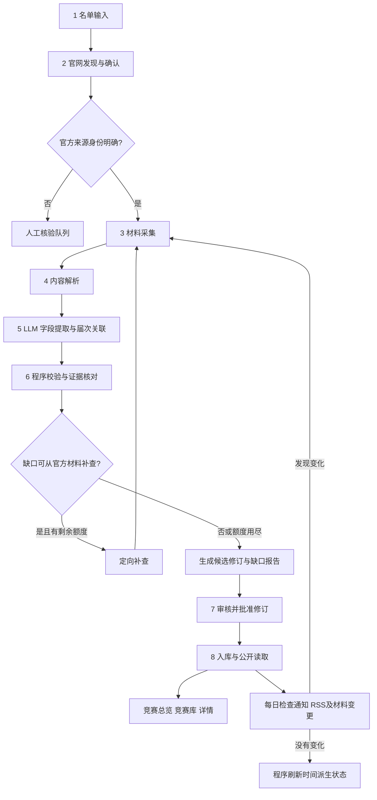

# 竞赛 Agent 完整流程规划与实施边界

日期：2026-10-14。分支：`codex/competition`。版本：V0.3。本文保留产品目标及后续设计；实际运行顺序、能力边界、恢复命令和接手规范见[工作流复用手册](../modules/competition/WORKFLOW.md)。

使用者确认的六步：名单输入 → 官网发现 → 材料采集 → 内容解析 → 字段提取 → 校验。本规划补充缺口补查、修订审核、入库发布和每日更新。这里把“官网放下”理解为“官网发现与确认”，“校研”理解为“校验”。

官网到候选数据库的工具、任务、真实模型提取、校验和修订入库已经实现并运行，全31项字段语义验收尚未完成。每日调度已声明但开关关闭；审核、公开发布、状态派生和前端尚未实施。下文审核／发布节点是后续设计，不是当前运行能力。业务字段严格遵循[模块 README](../modules/competition/README.md)，首批范围为[31项学校名录](../modules/competition/catalogue.md)。

## 1. 目标与执行方式

输入竞赛全称和学校级别，系统自行寻找可信官方入口、RSS和通知栏目，整理官方材料，生成带字段证据的竞赛记录。每天检查已确认来源，重点识别报名、比赛时间、赛段变化；根据时间计算报名状态和当前赛段，供总览、竞赛库、详情页读取。

第一版由一个后台工作流协调有限工具调用。官网发现和缺口补查允许 Agent 根据已有证据选择下一份材料；阶段执行、预算、存档和发布由后台编排。流程允许更换模型供应商，先复用仓库已有 Provider、worker、回执和预算能力，具体 SDK／模型在实现时决定。

学校级别来自名单；学科分类从使用者已确认的11个标签中多选，见模块backend/taxonomy.ts，不能自动创建标签。身份、证据和材料版本是内部管理信息，不增加读者业务字段。

## 2. 总体流程

审核规则是第一版建议，尚待使用者决定自动发布范围。审核可以退回指定节点补材料、纠正届次或拒绝当前修订。来源未确认和校验失败也可以直接进入人工核验，不能因为绕过补查阶段而进入发布。

## 3. 六个核心步骤

| 步骤 | 输入 | 程序／Agent 的工作 | 输出与完成条件 |
| --- | --- | --- | --- |
| 1 名单输入 | 竞赛全称、学校级别及适用范围 | 保留原名和原级别；检查重复；分配竞赛内部身份。名单照片或文件先转录并核对 | 名录条目；不确定的转录保留待核验。现有31项直接作为初始输入 |
| 2 官网发现 | 名录条目、历史候选 URL | Agent 搜索官方入口、组织方通知及交叉引用；程序读取候选页、验证域名和跳转；查找并实测 RSS 和通知列表 | 来源候选、官方身份依据、RSS／列表入口及读取方式；确认身份后才作为发布证据 |
| 3 材料采集 | 确认来源、目标届次／赛段 | 程序读取首页、报名通知、章程、赛程、更新通知、图片和附件；Agent 选择与字段缺口相关的材料 | 材料记录、内容指纹、抓取时间、发布／修订时间、实际读取结果；不能只抓首页 |
| 4 内容解析 | HTML、渲染页、PDF、DOCX、图片 | 网页正文清洗；表格保留关联；PDF／DOCX提取文字和页码；扫描件在需要时 OCR；动态页使用浏览器读取 | 带出处定位的内容块及解析质量；不可读文件保留失败原因，不冒充已解析 |
| 5 字段提取 | 内容块、名单、已确认分类、已有修订 | LLM 识别材料类型，关联竞赛／届次／赛段，提取批准字段和证据；基于材料生成简介 | 结构化字段候选、证据引用、未知项和冲突；级别按名单合并，LLM无权重判 |
| 6 校验 | 候选字段、材料证据、已有数据 | 程序检查结构、日期、计数、来源和关联；对容易混淆的材料关系进行模型复核；比较新旧值 | 通过项、错误项、缺口清单、变化清单；决定补查、人工核验或进入修订审核 |

### 官网发现的判断规则

官网标题、搜索排名、相似域名只能作为线索。接受来源需要有赛事组织方公告、可信机构站的明确指向、已确认官网的链接或官方材料中的网址等可核对依据。保存“依据在哪”，不依赖模型自报的置信分数。

只查找和收录指定名单。改名、合并或停办线索进入人工核验，不自动替换名录和学校级别。发现网站迁移时保留旧入口、新入口及官方迁移依据；动态页返回 HTTP200 空壳仍为未读取正文。

RSS须实际解析到订阅条目才能使用。RSS未找到时读取官网通知列表。RSS通常仅提供近期通知，首次资料建立还需读档案、章程和本届通知。

### 材料采集范围

首次围绕当前届或官方最新公布届次建立材料包：报名通知、章程／规则、各赛段时间、后续调整、对应宣传图和文件。官方尚未公布新届时保留旧届所属年份和状态，不把旧届改写为今年。

每份材料记录 URL、所属竞赛、抓取时间、内容类型、指纹及读取／解析状态。变更同一 URL 的正文或附件也产生新材料版本。公开优先提供官方原文和下载链接；内部研究存档与公开转载权限分别处理。

### 内容解析与图片

优先静态正文；确定为动态壳后使用浏览器渲染。公开接口只有在网页实际使用且可公开访问时才作为读取路径。OCR／视觉工具仅在真实材料需要且预算已批准时使用。

宣传图必须确认属于对应届次。Logo、获奖照片、二维码、器件示意图及无届次轮播图不直接当作竞赛主视觉。图像候选须检查可加载、页面上下文和对应届次；仍有歧义就留待核验。缺图允许缺省占位，不生成冒充官方的海报。

### 字段提取与范围

名称含届次；年份依据官方届次或赛季标识，跨年赛季同时保留官方年份表达和时间范围，单个年份的筛选口径在数据契约阶段确定。不能用发布日期或抓取年份替代竞赛年份。

时间、人数、教师限制都关联适用赛道／赛段。一个赛事有多个子赛或赛题时，先确定材料适用范围再提取，不能用局部规则覆盖全赛事。ICPC区域赛、C4名录列出的四个子赛、AIC赛题等按这一规则处理；CSP与CCSP保留两个名录身份及规则关系。

简介只说明竞赛内容和任务，不能夹带未批准的费用、奖项、主办方等新增字段。LLM输出证据中的关键原文短片段和位置；简介保存所依据的材料引用。

### 校验规则

- 结构与白名单：拒绝多出的业务字段；空值必须有原因；学校级别与名单一致；分类属于确认标签集合。
- 来源与定位：字段引用的材料存在，原文块／PDF页码可回看；网址属于确认来源或其官方附件链。
- 日期与精度：区分发布、报名、比赛、提交日期；保留时区和“月份／中旬／暂定”等表达；日期顺序异常进入核验。月级日期不转换成某日零点。
- 人数口径：分别保存学生、老师及官方总人数的含义；教师组不转换成一位教师；未写上限不视为不限。
- 身份与适用范围：检查名称、年份、赛道和阶段，拒绝混入旧届规则；通用有效章程可引用，但记录其版本和适用依据。
- 新旧变化：只更新明确被新材料覆盖的字段；较新的通知不自动废止全部旧材料；材料未提某字段不删除其原有有效值。
- 图片与文件：图像身份尚未验证或附件仅发现链接时，分别保留候选／发现状态，不记为已验证素材或已解析文件。

关键字段证据有缺口时可定向补查。来源身份、年份、届次或时间冲突未解决时，该修订停在待核验。字段证据缺失不能通过第二次模型“同意”来补足。

## 4. 缺口补查机制

校验生成明确的问题，例如“缺总决赛日期”“不知道队伍总人数是否含老师”“该图片是否属于2026届”。Agent根据问题选择官方通知、章程、附件或赛段页，读取后重跑受影响字段。

每次补查必须产出新材料、新依据或明确的访问结果。已读取材料无变化时不重复调用模型。补查受单竞赛工具次数、单次运行时长和费用额度限制；具体额度通过小样本实测后配置，耗尽时保存进度和缺口，供管理员处理。

| 缺失状态 | 含义 | 处理 |
| --- | --- | --- |
| 未知／未核验 | 当前材料包还不足以回答 | 尝试定向补查；保留待核验 |
| 已检查材料未说明 | 已检查指定官方规则，但没有该要求 | 保存已检查材料范围；不能声称整个官网永久未公布 |
| 不适用 | 官方规则证明该字段不适用 | 保存依据，例如个人认证的队伍人数口径；不能仅按赛事类型猜测 |
| 待公布 | 官方明确说具体安排另行通知 | 保留已公布精度，进入每日监测 |
| 获取／解析失败 | 超时、403、动态读取失败或扫描件不可读 | 标记失败节点；保持已有公开修订，允许管理员重新执行 |
| 冲突 | 同一届同一范围存在不同有效要求 | 保存两组值和依据，待判断调整关系或人工处理 |

## 5. 审核、入库与发布

建议首版所有新届首次发布经过管理员审核；后续涉及时间、人数、教师限制、赛段和官方入口的实质变化也先审核。去重、未变化检查和按既有日期计算状态由程序自动处理。是否开放其他自动发布范围属于待确认政策。

审核页面至少提供：竞赛／届次、字段候选、旧新差异、官方原文／附件定位、宣传图、缺口与冲突，以及批准、退回补查、纠正关联和拒绝操作。批准绑定具体候选修订和材料版本，材料变化后的新结果需形成新修订。

缺宣传图或非关键限制字段有未知状态时，可以由管理员批准带明确缺失说明的记录。缺报名／比赛时间时，首版建议保留后台草稿，待补到官方时间表达或明确“待公布”依据后再审；不自动进入“正在报名／正在比赛”等入口。最新候选失败不覆盖已有公开数据。

入库保存竞赛身份、本届记录、材料版本、字段证据和候选／批准修订。公开读取只返回当前批准修订；数据详情、筛选、总览由同一读取层提供。流程执行状态与竞赛报名／比赛状态分开保存。

执行节点依次为 `input → discover → collect → parse → extract → validate`，补查返回指定的采集／解析节点；任务结果分别为完成、等待人工处理、失败或预算停止。修订状态单独使用 `draft → needs_review → approved`，并支持拒绝和被新修订替代。公开读取引用当前批准修订，不把任务“执行完成”当成内容“审核通过”。

失败后可从已存材料或候选修订继续，保留失败节点和依据；重新提取形成新候选，不覆盖历史证据。定时任务重复触发同一材料版本时，使用任务身份及材料指纹防止重复发布和重复付费，沿用共享任务机制。

## 6. 每日更新流程

每日一次检查已确认官网RSS／通知列表及与当前记录关联的重要材料。当前调度声明为Asia/Shanghai每日02:20，开关关闭、未运行常驻任务；以下完整变化审核与状态派生仍待实施和部署验收。

1. 读取新的订阅条目／列表记录，比较已有材料指纹；同时检查关联关键材料是否在原URL更新。
2. 对变化材料执行解析、LLM提取、身份关联、校验和补查。
3. 输出同届变化报告，如报名延期、阶段调整、新文件、旧公告撤回或新届开始；进入相应审核路径。
4. 基于当前批准日期和赛段自动刷新状态与下一节点；没有新通知也执行此步骤。
5. 保存本次运行成功项、失败项、未解决缺口和模型费用，供后台查询。

报名和比赛进度允许同时表达：竞赛已经启动时，部分赛道仍可能可报名。所有状态按适用范围计算，不给整个竞赛强行套一个互斥状态。月份／待公布节点不计算精确倒计时；多个报名截止分别展示其范围。

官网抓取失败表示“本次检查失败”，不能推导为比赛结束。新届记录单独创建，保留历史届次。官网出现更名／迁移／合并时重新进行来源核验。

## 7. 输出契约与工具边界

以下描述目标输出结构，当前已实现的契约和候选数据库对象见复用手册；批准修订、公开读取及完整变化报告仍为后续设计。

| 输出对象 | 内容 |
| --- | --- |
| 名录输入 | 内部ID、原全称、学校级别及适用范围；学校级别可有主体／专项差异 |
| 来源记录 | 官网、RSS／通知入口、来源身份依据、确认状态、读取方式 |
| 材料记录 | 材料ID、URL、指纹、抓取时间、官方发布时间、内容块、定位和解析状态 |
| 字段候选 | 字段路径、值、适用届次／赛段、缺失状态、材料证据引用 |
| 校验报告 | 通过项、错误、缺口、冲突、补查问题及与批准修订的差异 |
| 候选修订 | 一组字段候选、依赖材料版本、审核状态；批准后形成公开修订 |
| 运行记录 | 执行节点、耗时、工具／模型调用结果、费用回执、停止原因 |

业务结果仅含：名称、年份、宣传图、分类、学校级别、人数限制、指导老师限制、报名时间、比赛时间、赛段、官网链接、文件、简介。证据与缺失状态包裹字段供内部核验，不作为新的竞赛信息类别。学校级别由名单直接填充；分类仅在标签集合批准后自动提取。

建议工具划分：

| 工具能力 | 作用 | 边界 |
| --- | --- | --- |
| 搜索与候选页面读取 | 官网发现、身份交叉验证、缺口定位 | 搜索摘要只用于发现，正式字段回到官方原文 |
| RSS／列表读取 | 增量发现通知与附件入口 | 已确认来源；实测XML；首次需要档案材料 |
| 静态／浏览器读取 | 读取HTML或动态页及公开附件链接 | 复用请求安全；不绕过登录／验证码，不把页面指令当系统指令 |
| 文件读取与解析 | PDF、DOCX、必要的OCR和图片核验 | 类型／大小／预算限制；来源和定位可回看 |
| 资料查询 | 读取原名单、材料、旧修订、批准分类 | 只读竞赛范围，不访问其他模块内容或密钥 |
| 提交候选与补查请求 | 写研究候选、证据、校验结果 | Agent无直接发布权限；批准由后台操作完成 |

外部网页和文件作为数据处理，不接受其中要求调用工具、更改级别、扩大名单或发送资料的指令。全流程以竞赛ID和任务ID限定读写范围。

## 8. 后端隔离与三层前端

竞赛来源、提示词、工具编排、数据和测试放在 `modules/competition/`。沿用仓库后台worker执行模型调用，每次付费请求经过 `providers/receipts.ts` 及预算熔断。开发阶段采集、模型和推送安全开关保持关闭，使用本地假服务测试。

公开数据通过 `packages/backend/src/publication/` 读取，再由HTTP接口供前端使用。页面打开、筛选、刷新不启动模型或采集。

| 页面 | 使用批准数据的方式 |
| --- | --- |
| 总览 | 按有效报名／竞赛时间、赛段和已确认学科分类组织入口；重点竞赛名单及截止阈值待使用者决定 |
| 全部竞赛库 | 搜索名称，按分类、学校级别、年份和派生状态筛选，整卡进入详情 |
| 详情 | 宣传图、简介、字段事实、带范围的时间线、官网和官方文件；缺失项清楚标注 |

已有世界新闻依赖仍需实施前检查和整合，不能假设当前main已提供全部共享模块能力。本规划不自动合并分支。

## 9. 实施顺序与验收

| 阶段 | 交付与验收 |
| --- | --- |
| A 数据和流程契约 | 明确字段类型、跨年年份口径、适用范围、证据位置、工作状态、审核规则和公开接口 |
| B 工具与本地工作流 | 用本地真实材料样本／假模型完成六步、定向补查、修订审核和公开读取；模型与外网开关关闭 |
| C 小批真实验证 | 在获准预算内验证AIC的RSS＋附件、数媒网页＋PDF、一个已确认动态官网；分别报告字段正确性、缺口和费用 |
| D 扩展名录 | 逐项运行31项；014、016保持身份待核验；C4四个子赛及各赛事赛题分别检查 |
| E 每日更新和前端 | 验证通知变化、原URL修订、没有新材料但跨越时间节点、局部失败及三层页面输出 |

当前来源报告说明可以推进工具设计，但完整字段、图片与附件解析仍存在缺口；不能将其“可进入提取”计为已完成验收。参见[字段可获取性复核](../modules/competition/verification/2026-10-14-field-availability.md)。

首版重要验收案例：旧届不能写入新届；队伍总人数含老师时口径不丢；只有月份不生成精确日期；延期只修改对应赛段；重复材料不重复提取；未经验证的官方域名不发布；模型额外字段被拒绝；关键字段都有原文依据；解析失败与官方未说明分开；材料不足不会持续无界补查；未变化的已知材料不产生新模型费用；页面请求不产生模型调用。

小批验证按人工核对的真实样本逐字段对照，分别统计值、范围、年份、时区、证据和缺失原因是否正确。发布的关键字段要求逐条人工确认；自动化比例及模型选型根据错例和费用确定，不先凭感觉设准确率门槛。

## 10. 待确定的产品选择

六步主线、仅使用名单、自动发现官网／RSS目标、每天检查时间和状态目标、第一轮字段范围均已确认。11个分类标签已批准，验收模型预算已授权两轮各10元；02:20调度声明未启用。仍需确定或部署前确认跨年年份筛选口径、首发和重要变更审核方式、首页重点名单／排序及长期运行时间和费用政策。

这些选择不影响先设计字段证据、解析工具和本地工作流。优先细化“步骤5的结构化输出＋步骤6的校验”，然后实现采集与解析工具，最后连接每日任务和前端。
