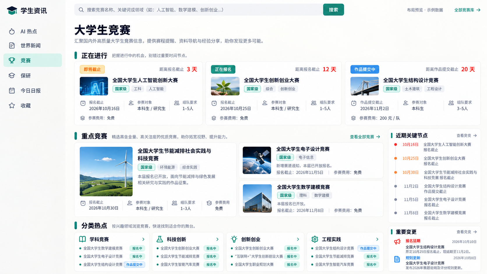
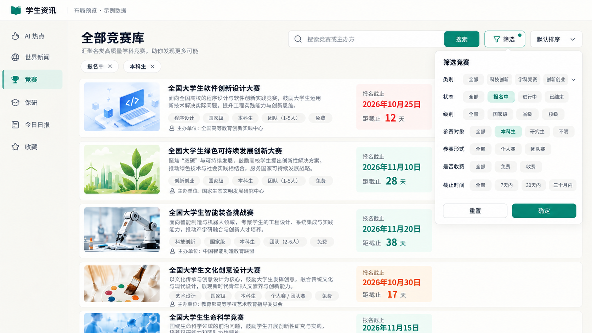
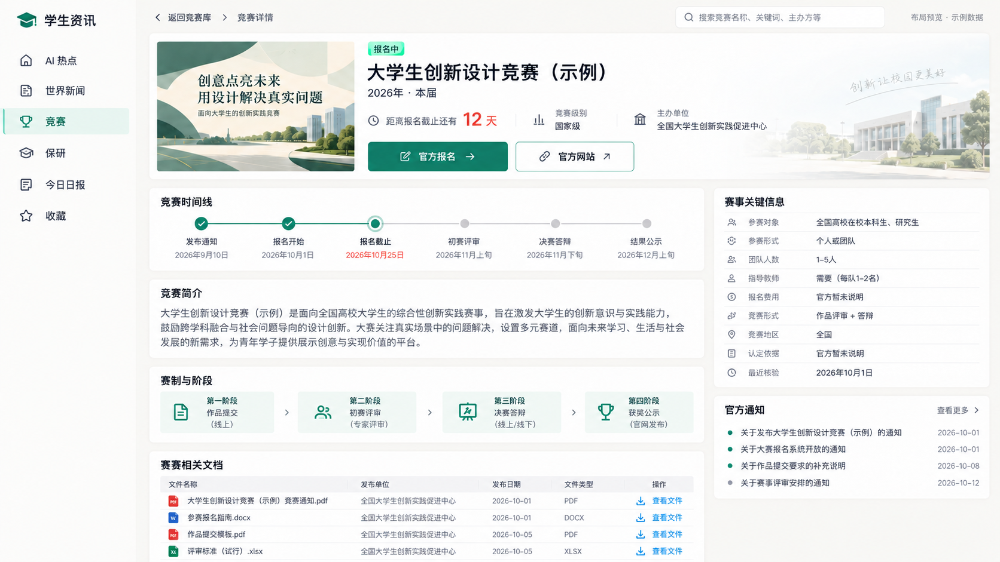

# 大学生竞赛板块前端设计指南

- 日期：2026-10-13
- 版本：V0.1
- 分支：`codex/competition`
- 状态：已讨论页面骨架并按使用者反馈修订；本次保存规划与三张预览图，页面和接口尚未实现。

本文参照世界新闻的“总览 → 完整列表 → 详情”组织方式，记录本轮竞赛页面讨论。文字要求优先于概念图；图中竞赛、主办方、级别、日期、费用和人数全部是示例，不能作为真实材料或收录依据。

2026-10-13 字段范围收紧：以[模块 README 第一轮开发规范](../modules/competition/README.md#第一轮开发规范只收录以下信息)为唯一业务字段清单，仅保留名称（含届次）、年份、宣传图片、分类、学校认定级别、人数限制、指导老师限制、报名和竞赛时间、赛段、官网链接和文件、内容简介。以下文字已同步调整；概念图保留历史布局参考，超出清单的信息不实施。

## 1. 定位与导航

服务大学生查找竞赛、判断能否参加、掌握时间节点并取得官方资料。竞赛是独立大模块，未来由 `modules/competition/` 提供自己的页面、导航、后台、规则和流程；AI 与世界新闻仍各自组织。

复用现有网站的侧栏、配色、字体、卡片与收藏体验，通过模块新增竞赛入口。图中的“学生资讯”是占位品牌；保研、账号、通知等尚未实现的入口不因概念图而自动加入网站。

| 页面 | 拟定地址 | 用户目标 |
| --- | --- | --- |
| 竞赛总览 | `/competitions` | 发现正在进行和值得关注的竞赛 |
| 全部竞赛库 | `/competitions/library` | 搜索、筛选全部已收录竞赛 |
| 竞赛详情 | 待设计稳定竞赛及届次地址 | 查看本届条件、时间线、图片和官方资料 |

路径为规划值。详情身份必须区分竞赛项目与具体届次；年份不能代替届次唯一身份，同一年多届或多个赛道须可表达。

## 2. 竞赛总览

使用者确认总览包含正在进行、热点／重点竞赛、分类热点；展示内容应回应学生实际关心的问题，不能随机填满栏目。

建议布局由上到下为：标题、搜索与竞赛库入口 → 正在进行 → 重点竞赛与近期关键节点 → 分类热点与重要变更。节点与变更可在桌面右栏展示，手机顺序排列。

- 正在进行：展示仍有行动空间的本届竞赛，明确区分正在报名、作品提交、比赛／评审等阶段。
- 重点竞赛：以使用者稍后提供的重点名单为候选，结合当前节点编排；每项展示可核对的理由，如报名开放或新赛题发布。
- 分类热点：每类直接列出竞赛与状态，附进入已筛选竞赛库的入口；不只放泛化分类介绍。
- 近期关键节点：展示报名、提交、比赛等节点，清楚标记节点类型。
- 重要变更：仅展示本轮字段内已核验的时间、人数、指导老师限制或赛段变化，并链接详情和官方依据。

首屏卡片优先呈现名称（含届次）、年份、从时间与赛段派生的状态、下一节点、日期及剩余天数；其次为人数限制、指导老师限制与学校认定级别。报名和各赛段时间分开表达，不能因比赛进行中而误以为仍可报名。

“重点”不等于全网热度。名单、重要性、噪声边界、排序和即将截止天数尚待使用者确定；不自定生产权重、门槛或暗示含金量。未来有可靠热度数据时另行设计。尚无个人信息与学校配置，不能宣称已做个性化匹配。

## 3. 全部竞赛库

使用者最新反馈：顶部只保留搜索及类似购物平台的筛选按钮，完整条件放在按钮展开的面板里；删除列表卡片右侧“查看详情”和“官方网站”按钮，通过竞赛标题或整卡进入详情。

- 搜索框按竞赛名称检索，届次包含在名称中。
- 筛选面板仅围绕本轮字段及其派生状态设计，如分类、学校认定级别、年份、赛段与时间；具体条件后续讨论，不增加费用、参赛对象等筛选字段。
- 面板包含重置与确定，关闭后页面仅显示简短的已选条件，可逐项取消。
- 排序、结果数量和分页与筛选一致；返回列表恢复关键词、条件、页码和位置。
- 列表卡片呈现小幅图片、名称、简介、参赛条件和下一节点。右侧保留时间信息，删除两个操作按钮。
- 整卡入口需支持键盘；收藏作为独立操作时避免与卡片跳转冲突。
- 竞赛库保留历史届次的访问能力，如何默认展示当前届及切换历史届次在数据与接口阶段确定。

概念图展示筛选面板展开状态，默认应收起。手机可使用抽屉或弹层，具体交互在实现时验证；筛选项超出视口可滚动，确定按钮保持可达。

## 4. 竞赛详情

使用者认可详情页整体布局，明确删除右下角“相关链接”卡片，不把重复链接区移到其他位置。按最新第一轮字段清单，顶部保留官方网站入口，旧图中的独立官方报名入口不实施。

首屏包含宣传图片、名称（含届次）、年份、派生状态、下一节点及日期、倒计时与学校认定级别，提供返回、官方网站及收藏入口。本轮仅保留官网链接，不另设官方报名按钮与独立报名链接字段。真实缺图时使用文字布局，不生成冒充官方宣传的海报。

桌面左侧宽内容区、右侧辅助信息区；手机优先展示参赛关键信息和时间，再展示长文。

| 区域 | 内容 |
| --- | --- |
| 时间线 | 官方明确的报名时间与各赛段竞赛时间；区分已完成、当前阶段、未来与日期待定 |
| 关键信息 | 年份、分类、学校认定级别、人数限制、指导老师限制 |
| 竞赛简介 | 基于官方材料的简短内容介绍 |
| 赛段 | 官方明确的比赛阶段及对应时间，不增加完整赛制字段 |
| 竞赛相关文档 | 通知、章程、报名表、模板、赛题、技术规范、延期通知、结果文件 |
| 官方通知 | 作为相关文件或官网来源入口组织，不另建超出本轮范围的通知产品 |

文件显示名称、发布机构、日期、类型、适用届次与官方查看／下载入口；大小只在可靠取得时显示。优先链接官方文件，重新托管与存档权限另行确认。图片使用也须记录来源与许可边界。

未知人数、指导老师限制或时间显示待确认／官方暂未说明，不能默认不限或补造日期。级别由使用者提供学校标准，材料中的“全国举办”不能自动认定为该学校的国家级。

延期等变更保留原值、新值、范围和官方证据。多个赛道或学校截止不同，页面须说明适用范围，不以一个日期覆盖全部条件。本站最近核验时间与官方发布日期分别显示。

## 5. 页面状态与验收目标

实现时覆盖桌面及手机浏览、搜索、筛选、进入详情、收藏和返回；缺图、长标题、多个截止日、历史届次和资料不足仍可阅读。加载、空库、无筛选结果、服务失败、撤回和过期分别表达。

前端只通过 HTTP 读取公开 API，公开数据经统一 publication 层；页面访问不调用模型。筛选和倒计时使用已核验数据，原始提取草稿不直接出现在页面。

验收特别检查：默认收起筛选、面板筛选生效、列表无两个冗余按钮、详情无相关链接卡、节点类型可区分、文件归属正确、总览展示理由可说明、旧 AI／世界新闻内容与收藏不串。

## 6. 待确认与后置

31个目录条目及学校级别已保存至[竞赛名录](../modules/competition/catalogue.md)。分类已确认按学科方向且允许重叠，具体标签、官方信源、重要性、噪声和排序仍待确定；图中的分类与元数据不能直接写成生产配置。第一轮严格遵守 README 字段清单，不继续扩展收录内容。

截止提醒、日历订阅、账号画像、组队、微信／QQ触达、竞赛日报和新增外部出口后置。当前授权仅为规划、图片入库、建立分支与提交推送；前后端实施、真实采集与付费验证尚未开展。

后台流程与隔离方案见[竞赛模块规划](competition-isolation.md)。
