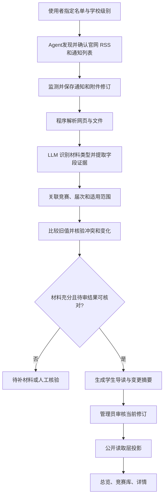

# 大学生竞赛模块隔离与后台流程规划

- 日期：2026-10-13；分支：`codex/competition`；版本：V0.1。
- 当前状态（2026-10-15）：独立模块、迁移、采集解析及候选入库已实现并验收；定时任务已声明但未启用，公开接口、展示版本机制与页面未实现。下文保留早期设计背景，当前事实见模块README，后续实施以[开发指导README](../modules/competition/DEVELOPMENT-README.md)为准。
- 前端指导：[三层页面规划](competition-frontend.md)；模块入口：[模块说明](../modules/competition/README.md)。

2026-10-13 更新：第一轮业务字段严格以[模块 README 开发规范](../modules/competition/README.md#第一轮开发规范只收录以下信息)为准，覆盖此前更广的建议。内部证据、身份与审核机制不构成扩展业务字段的授权。

## 1. 目标和已确认边界

独立服务大学生竞赛，首批范围为已保存的31项学校名录。形成官方资料整理、结构化竞赛库、节点更新、变更核验与三层读者页面的闭环。使用者确认详情布局，删除重复链接区；竞赛库筛选收进按钮面板，列表整卡进入详情；总览优先展示学生关心的机会和节点。

不将竞赛当成另一套世界新闻评分和事件热度。本轮只整理名称（含届次）、年份、宣传图片、分类、学校认定级别、人数限制、指导老师限制、报名和竞赛时间、赛段、官网链接和文件、内容简介；分类与展示标准仍须讨论。

## 2. Git 基线与共享能力依赖

本分支从最新 `origin/main` 的 `98d40a3` 创建。参考的世界新闻实现位于 `codex/world-news` 的 `180934b`，当时尚未合并到 main。本次未合并世界新闻或复制其运行代码。

后续实现前须整合经过审查的共享能力依赖，再设计竞赛身份、资源约束与模块接口。不能假定当前 main 已有世界新闻的 section 服务。本次文档不授权自动合并 main。

世界新闻参考文档：[前端指南](https://github.com/OceanFranky/ALL-NEWS/blob/180934b81be3f5c05baf175c60dc63bba292e7e5/docs/world-news-frontend.md)、[隔离规划](https://github.com/OceanFranky/ALL-NEWS/blob/180934b81be3f5c05baf175c60dc63bba292e7e5/docs/world-news-isolation.md)。固定提交链接用于参考组织方式，历史进度以该分支工作日志为准。

## 3. 模块归属与复用原则

竞赛专属页面、字段、信源、规则、提示词、附件处理、编排及测试集中在 `modules/competition/`。npm包、`module.ts`及`server.ts`已按[架构的模块约定](architecture.md#模块)接入站点，前端入口后续实施；已安装不代表采集／模型安全开关已启用。

| 能力 | 可复用基础 | 竞赛独立部分 |
| --- | --- | --- |
| 采集 | 请求安全、列表读取、来源管理 | 指定名单、官方网页与附件范围、采集计划 |
| 资料管理 | 身份、修订和去重机制 | 项目、届次、赛道、文件和字段证据 |
| 模型 | Provider、worker、回执、预算 | 提取、关联、差异核验、学生导读的独立规则 |
| 审核 | 登录、CSRF、审计、版本绑定 | 字段冲突、届次核验、变更批准和撤回 |
| 公开读取 | publication 统一读取边界 | 竞赛结构化结果、当前修订、资料许可 |
| 前端 | 现有视觉、模块导航、收藏交互 | 总览、竞赛库与详情 |

专属表迁移放在模块 `migrations/`，共享表扩展迁移放在 `database/migrations/`，遵循新文件、在线单语句与索引约定。不得为了让竞赛跑通而改写世界新闻或 AI 数据。

## 4. 数据身份与信息模型

以下是概念模型，具体 schema、字段名和迁移尚待设计：

- 竞赛身份：内部区分不同竞赛和届次；读者名称包含届次，不另增届次展示字段。
- 本届信息：年份、名称、宣传图片、分类、学校认定级别与内容简介；同年可多届。
- 赛段／适用范围：仅为本轮时间、人数与指导老师限制记录适用阶段，避免混淆；不扩展学历、专业、地区等独立条件字段。
- 时间节点：类型、官方时间表达、可解析时间、时区、适用范围、证据与修订。只写月份或“中旬”的材料保留精度，不补造具体日期。
- 限制条件：人数限制与指导老师限制，保持官方表达及适用赛段。
- 官方资料：网页、通知和附件的来源 URL、发布日期、材料修订、内容指纹、适用届次与使用权限。
- 字段证据与变更：字段原文片段／页码、旧新值、所依材料版本、冲突状态及审核记录。
- 公开结果：审核通过的本届信息及可读资料，不直接暴露未核验提取结果。

级别按使用者提供的学校标准登记，不能由模型统一判定；赛段独立于学校级别。本轮不增加举办范围、认可名单等业务字段。宣传图为官方素材或许可素材，缺图不补造；附件优先链接官方地址。

## 5. Agent／LLM 工作流

2026-10-14：使用者确认六步主线：名单输入、官网发现、材料采集、内容解析、LLM字段提取、校验。完整节点、工具、补查、修订与每日更新方案以[竞赛 Agent 流程规划](competition-agent-workflow.md)为准；下图保留概览。官网发现和字段缺口补查允许有限工具选择，执行范围与预算由后台编排。

| 步骤 | 输出与核验 |
| --- | --- |
| 材料识别 | 区分章程、报名、赛题、延期、结果、宣传和无关材料；重复转发不代表独立证据 |
| 提取 | 仅提取 README 清单中的信息及其原文依据；级别遵循使用者提供的学校标准，缺失留空 |
| 关联 | 确定项目、届次、赛道、阶段；不确定进入待核验，不覆盖旧届 |
| 差异核验 | 比较同范围新旧要求，输出变化及证据；不凭较新时间就判定旧规则全部失效 |
| 导读 | 生成清单内的内容简介，限定在官方材料范围内，不借导读扩展未批准字段 |
| 首页候选 | 依据批准名单与规则提出展示候选及理由，不生成全网热度或无依据含金量 |

程序负责定时执行、文件解析、格式校验、时间计算、状态推导、筛选和页面读取。是否使用 OCR、图片理解、文件解析库及付费服务，需以真实文件样本评估后决定，不预设所有附件都可解析。

LLM 处理理解与关联，结果经 schema 和证据检查；字段冲突、范围不明、不可解析文件进入待核验。人工负责首批材料与关键变更审核，以及重点范围和展示规则，作为首版建议，具体自动发布范围待使用者确认。核验模型不能替代官方证据。

## 6. 运行、权限与隔离

竞赛使用显式领域身份，具体 SectionId 扩展及独立实体边界在实现设计中确定；来源、任务、模型配置、回执、预算、缓存、搜索、后台操作和收藏须能核对所属模块及实际资源。禁止进程级可变“当前模块”，缺竞赛规则不回退 AI／world。

竞赛的公开接口拟使用 `/api/v1/competitions/`，后台拟使用 `/admin/competitions` 与对应管理员 API；契约尚未实现。所有公开出口经 `packages/backend/src/publication/`；读者页面只读 HTTP，不触发采集、模型、补查或附件解析。

首次发布和关键变更审核绑定材料／结果修订，原始候选、冲突和失效引用不能继续作为当前公开结论。来源撤销许可或资料撤回后，公开读取必须及时核验。

付费请求复用现有回执与总预算机制，竞赛另设经批准的配置和额度；世界新闻既有费用授权不扩展为竞赛授权。本轮不读取密钥、不启用竞赛采集／模型、不调整现有容器和开关。

后台需要具备来源及材料查看、提取结果与证据核验、关联纠正、字段冲突处理、变更审查、发布撤回、运行和费用记录。具体页面和权限契约后续设计，不能通过直接改库代替可审计操作。

## 7. 实施阶段与验收

| 阶段 | 交付 | 验收依据 |
| --- | --- | --- |
| 1 需求与资料确认 | 指定名单、真实通知样本、分类和展示标准 | 使用者确认范围，关键字段可回溯官方资料 |
| 2 隔离与契约设计 | 共享依赖、实体模型、迁移、任务、API 与预算方案 | 跨模块操作拒绝，旧 AI／world 行为保持 |
| 3 本地后台闭环 | 夹具网页与附件、本地假模型、审核与公开投影 | 实际 worker 流程覆盖提取、关联、冲突、延期、撤回 |
| 4 三层读者页面 | 总览、库、详情、筛选、收藏 | 符合前端指南，桌面手机及错误状态验证 |
| 5 真实小批验证 | 获准来源读取与限定付费调用、证据和费用报告 | 真材料准确率、错例、失败、费用分别报告 |

按批准范围实施，每次交付展示差异、验证与未完成项。实现涉及业务代码时执行仓库完整检查；当前纯文档与图片只做差异及引用检查，不重跑世界新闻业务验收。

关键验收目标包括：提取／接口／页面只含本轮业务字段；名称包含届次；年份不取抓取年份；级别遵循学校标准；同竞赛不同届次不覆盖；同材料重采不重复；多个截止范围不混淆；冲突不自动发布；延期可追溯；无权资料不可读；AI／world／竞赛任务和公开出口不串；页面读取无新增付费调用。

## 8. 下一步与未定事项

31个目录条目及学校级别已保存至[竞赛名录](../modules/competition/catalogue.md)。分类按学科方向且允许重叠，具体标签、官方信源、重要性与噪声、重点排序、即将截止阈值尚未冻结。内部届次身份与路由、清单内字段 schema、来源许可、图片附件处理和预算需要真实样本后定案。使用者只提供名单；Agent自行发现官网及RSS，计划每日读取官网通知关注时间与派生状态，无RSS则读取通知列表。本次[来源检查](../modules/competition/verification/2026-10-13-source-feasibility.md)仅验证可获取性，不启用调度；首次发布与变更审核方式待决定。

2026-10-15进度纠正：此前“未实现采集／工作流／数据库”的描述已过时，31项候选入库阶段已验收；公开服务与前端仍待实施。通知、个性化、日历、组队、日报与其他出口均后置。
