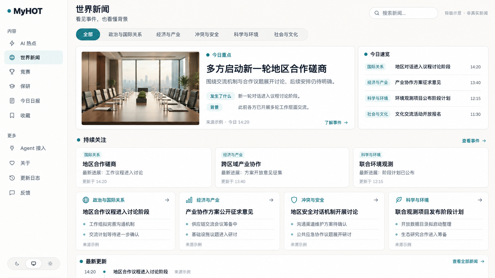
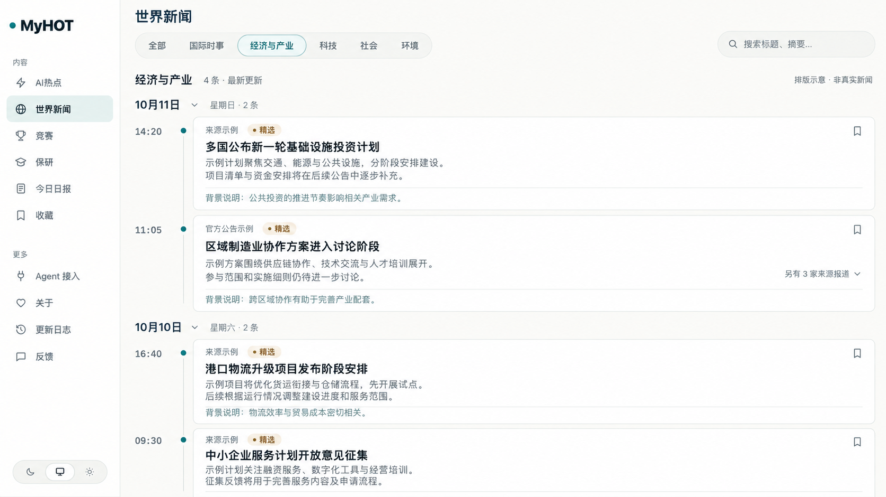
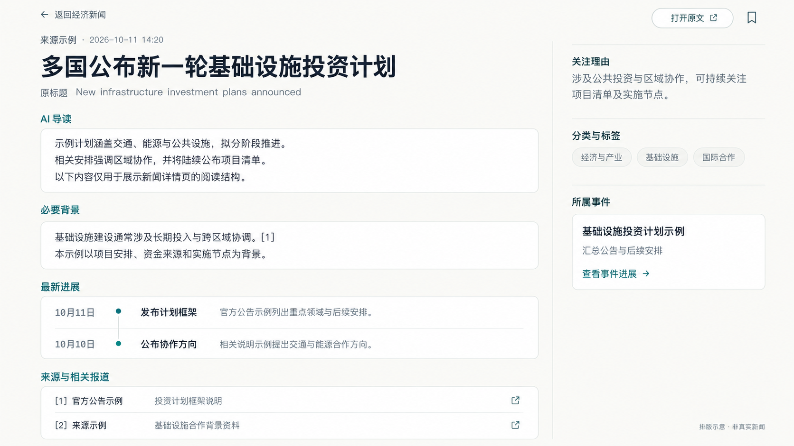

# 世界新闻板块前端设计指南

- 日期：2026-10-11
- 版本：V0.1
- 状态：三张读者页面已实现并接入公开 API；localhost 已按使用者授权用临时许可完整演示，正式部署前必须撤销临时许可，生产自动精选仍受正式许可与校准限制
- 开发分支：`codex/world-news`

2026-10-12 实施：已完成总览 `/world`、分类时间线 `/world/timeline` 和新闻详情 `/world/items/:id`。使用者补充要求与现有前端保持一致，因此复用当前侧栏、配色、字体、PillTabs、收藏与卡片样式，三张图仅指导信息布局。详见[前端交接与最新验收状态](world-news-handoff.md)。

本文汇总世界新闻板块已讨论并认可的排版方向，是该板块后续前端开发的总指导。效果图帮助理解视觉和布局；文字要求说明交互与信息组织。二者有差异时，以本文明确的要求为准。新的产品选择须与使用者确认，并更新本指南。

## 1. 定位与全站导航

世界新闻帮助学生快速了解重要事件，并沿着背景和进展继续阅读。延续现有网站的视觉语言，同时用总览式排版突出重点；分类页和新闻详情页沿用熟悉的时间线与阅读布局。

原概念图的侧栏规划如下；按使用者最新要求，本次保留当前导航，只通过模块增加世界新闻入口，不添加尚未实现的竞赛／保研入口，也不移除原有主题入口：

1. AI 热点
2. 世界新闻
3. 竞赛
4. 保研
5. 今日日报
6. 收藏

暂时不提供“主题”入口。“更多”保留 Agent 接入、关于、更新日志和反馈。站名由使用者决定，图中的 MyHOT 仅是当前占位；这些其他板块的功能不属于本文的实施范围。

## 2. 三层浏览结构

| 页面 | 布局 | 用户目标 |
| --- | --- | --- |
| 世界新闻总览 | 今日重点、今日速览、持续关注、分类栏目、最新更新 | 快速了解全局 |
| 分类页 | 顶部分类导航、日期分组时间线 | 深入浏览政治、经济等领域 |
| 单条新闻详情 | 宽正文区、右侧辅助信息 | 阅读摘要与背景，查看进展和原文 |

交互路径：世界新闻总览 → 点击分类 → 分类时间线 → 点击新闻标题 → 新闻详情。总览中的新闻入口也可直接进入详情。

“持续关注”卡片指向事件及其进展，而普通新闻卡片指向单条新闻；具体事件页的设计另行细化，不将两种入口混淆。

## 3. 顶部分类导航

顶部采用与当前站点相近的圆角胶囊导航，明确显示选中项。“全部”对应世界新闻总览；点击具体分类后，下方切换为该分类的时间线。

已确定的分类：

- 全部
- 政治与国际关系
- 经济与产业
- 冲突与安全

图中“国际时事”“科技”“社会”“环境”等不同写法是早期视觉参考，不增加第四、第五类。后端键依次为 `politics`、`economy`、`security`；接口使用方式见[世界新闻公开 API](world-news-api.md)。

搜索在当前世界新闻板块内工作；分类页应明确当前搜索范围。最终搜索行为及分类参数随接口设计确定。

2026-10-12 后端实施边界：今日重点与今日速览取已批准的世界日报；持续关注卡片暂不填内容；订阅列表明确提供的主图已经接入，详情页图片抓取、单条新闻扩展字段、无依据背景和卡片内多来源展开仍后置。

## 4. 世界新闻总览

内容从上到下依次为：

1. 页面标题、简短介绍、搜索与分类导航。
2. 今日重点和今日速览。
3. 持续关注。
4. 分类栏目。
5. 最新更新。

### 今日重点与今日速览

桌面端并排展示，今日重点约占三分之二，今日速览约占三分之一。

今日重点突出一条重要新闻或事件，展示标题、短摘要、来源、时间和详情入口，可增加简短的“发生了什么”“背景”。有合适图片时使用，无图时保持完整的文字布局，不强制生成新闻配图。

今日速览最多展示 8 条简讯，用短标题、分类及时间帮助快速扫描，避免每条都变成长卡片；日报中的其余内容仍保留在接口和后台修订中。

### 持续关注

建议展示 2–3 个持续演变的事件。每张卡片包含事件名称、分类、最新进展、更新时间及事件入口。突出“这次有什么变化”，避免反复展示相似标题。

### 分类栏目

展示各分类的一条重点新闻和少量简讯，并提供进入该分类的入口。最终只有三个固定分类，因此宽屏使用三列等宽，中等屏幕两列、手机单列，避免第三张卡片单独占据下一行。

### 最新更新

底部提供简洁时间列表及“查看全部新闻”入口，供继续浏览。此入口表示世界新闻的完整时间线；顶部“全部”仍表示总览，二者用途应清楚。完整时间线可复用分类列表布局，具体路由另行确定。

### 总览效果图

## 5. 分类页：日期分组时间线

选中政治、经济或其他具体分类后，保留侧栏、页面标题、搜索和分类导航，下方使用时间线。该页面不重复总览中的重点区、速览和分类网格。

- 显示当前分类名称。
- 按日期分组，日期旁显示星期与条数；可折叠某一天。
- 每个条目左侧显示时间、圆点与连接线，右侧使用宽新闻卡片。
- 卡片包含来源、精选标记（适用时）、标题、摘要和收藏按钮。
- 有背景资料时可显示简短背景说明，不强行为所有新闻补齐。
- 同一事件的多来源报道可显示“另有 X 家来源报道”并展开，避免重复刷屏。
- 推荐新内容在前；具体排序采用的时间字段必须与后端约定，不把发现时间伪装成原文发布时间。
- 返回分类页时恢复选中分类、筛选和滚动位置。

世界新闻前台建议隐藏 AI 评分和热度数字，保留来源与时间信息。该建议需在实现前明确，生成图按隐藏分数展示。

### 分类页效果图

## 6. 单条新闻详情

沿用现有新闻详情的阅读骨架：左侧为较宽正文，右侧为辅助信息。顶部提供返回、打开原文和收藏。

左侧顺序：

1. 来源与原文发布时间（未知时明确标记）。
2. 中文标题。
3. 原标题：外文新闻且可靠取得时展示。
4. 新闻摘要／AI 导读。
5. 必要背景：有资料依据时展示。
6. 最新进展：属于有后续的事件时展示。
7. 来源与相关报道。

右侧包含关注理由、分类与标签、所属事件及“查看事件进展”入口；不保留独立的主题模块。缺少某项内容时隐藏该区域，避免出现空卡片。

摘要、背景、机构或人物的说法、评论应清楚区分。背景和进展关联来源，不为填满布局生成无依据内容。有冲突或尚未确认的信息保留限定条件。

默认保留原文入口与摘要展示；全文和图片展示遵循来源权限。生成图中的示例正文、来源和引用不能直接用于生产内容。

### 详情页效果图

## 7. 视觉、移动端与页面状态

- 延续浅色暖白底、白色圆角卡片、细灰边框、深色文字和克制的青绿色强调。
- 总览通过主次不同的卡片建立阅读节奏；分类页通过日期与时间线组织内容；详情页优先正文可读性。
- 保持清楚的字体层级，避免每段都加边框或将页面装饰成数据监控台。
- 手机端按重点、速览、持续关注、分类栏目、最新更新顺序单列展示；分类导航可横向滚动。
- 时间线在手机端缩减左侧时间列，给标题和摘要留足空间。
- 详情页右侧内容折至主阅读区下方；原文与收藏入口仍容易找到。
- 加载、暂无内容、搜索无结果、获取失败、新闻已撤回分别呈现；失败不显示成“暂无新闻”。
- 状态不只依靠颜色；可通过键盘访问导航、链接、收藏和展开按钮。
- 从详情返回应恢复列表上下文；原有 AI 内容链接、收藏及阅读体验继续有效。

## 8. 实施边界与验收

本文指导前端排版，不表示新增采集、世界新闻筛选、事件背景和报告能力已经存在。实现前先定义页面所需字段、来源、时间含义和接口，再用真实样本检查布局。

遵循仓库约定：前端只通过 HTTP 读 API，公开内容经过 `packages/backend/src/publication/` 的统一读取边界，页面访问不触发模型调用。世界新闻与 AI 行业内容分别组织，不能直接混入 AI 精选、热点和日报。

验收至少覆盖：

- “全部”打开总览，具体分类打开日期时间线。
- 新闻入口进入新闻详情，持续关注入口进入对应事件。
- 分类、收藏和返回行为一致，来源与日期清楚可见。
- 长标题、无图片、无背景、未知时间和少量内容时布局仍成立。
- 多来源报道可查看，背景和进展能追溯证据。
- 桌面与手机端能完成浏览、阅读、收藏和打开原文流程。
- 空数据、错误及撤回状态准确，旧链接继续有效。

## 9. 后续工作

按已确定的三分类和[接口约定](world-news-api.md)制作可点击页面并验证。世界新闻相关修改继续在 `codex/world-news` 分支推进，按任务提交并更新 `aiwork.md`。

三张图片为 ImageGen 排版概念图，统一作为视觉参考保存在 `docs/assets/world-news/`。图中文字、虚构新闻及品牌占位不构成真实内容或授权信源。设计调整时保留版本，并同步修改本文。
