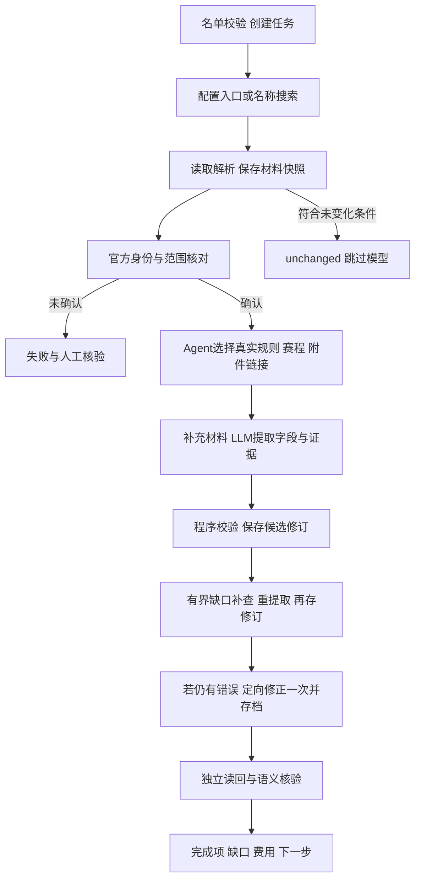

# 竞赛 Agent 工作流复用手册

版本V1.0，2026-10-14，分支`codex/competition`。记录实际实现与操作方法，不把人工调查包装成自动能力。目标设计见[流程规划](../../docs/competition-agent-workflow.md)，完成门槛见[验收标准](verification/acceptance.md)。

最新候选库阶段结果见[最终验收报告](verification/2026-10-14-final-ingestion.md)：31项都有候选，31项schema与原文读回通过；以下23:20之前的统计是历史，不代表全部字段齐全或所有来源发现已经全自动。

## 1. 目标和契约

本轮终点：**批准名单 → 官方材料 → 结构化提取 → PostgreSQL候选入库 → 独立读回验收**。不是前端上线或公开发布。

输入是全称、学校级别及收录范围，无需使用者提供网站。当前31项见catalogue.json；第16项仅学生网络信息安全赛项，C4仅名单四个子赛。改名、合并和学校级别由使用者确认。

模型仅提取12组：名称含届次、年份、宣传图片、分类、人数限制、指导老师限制、报名时间、竞赛时间、赛段、官网链接、文件、简介；学校认定另由名单合并。不得增加费用、主办方、奖项、学历等业务字段。证据、任务、来源和预算为内部管理信息。

分类使用backend/taxonomy.ts的11个批准标签，可重叠：程序设计与算法、软件开发、网络安全、人工智能与数据、计算机系统与硬件、数学与建模、数字媒体、创新创业、语言能力、职业发展、生物工程。

## 2. 完整执行链路



有界工作流而非无限循环；没有缺口或错误时跳过对应补查／修正。程序控制权限、次数、契约、预算、入库；模型负责身份判断、链接选择、字段理解和定向修正。先读原文才确认身份，每次提取即存候选，不等全部正确才入库。

| 节点 | 产物／门槛 | 模块内实现 |
| --- | --- | --- |
| 名单 | 原名、级别、范围不丢失，ID合法 | catalogue.json、scripts/import-catalogue.ts、backend/schema.ts |
| 官网发现 | 原文身份依据，聚合声明不能认官网 | sources.json、backend/discovery.ts、backend/workflow.ts |
| 采集 | 实际URL、抓取时间、hash、失败原因 | backend/materials.ts、backend/browser.ts、backend/plan.ts |
| 解析 | HTML块、PDF页、文档段落、ZIP条目、图片说明／OCR | backend/files.ts、backend/images.ts、backend/local-ocr.ts及OCR workers |
| 提取 | 名单范围＋标签＋材料；值、状态、理由、证据 | backend/extract.ts、backend/model.ts、backend/schema.ts |
| 校验补查 | 结构、原文、日期精度、URL、标签；只选实际链接，只修指定字段 | backend/schema.ts、backend/plan.ts、backend/repair.ts |
| 入库 | 用已存原文校验，绑定竞赛／任务／材料／回执，保留历史 | backend/repository.ts |
| 验收 | 全名单审计、独立读回、逐字段语义检查 | scripts/audit.ts、verification/ |

发现边界：31项已有研究种子，支持名称／明确简称搜索和身份核对，完全陌生名单自动找到全部官网／RSS／附件尚未验收。搜索摘要、排名、相似域名只作线索；没有RSS就读通知列表。人工定位公告、检查脚本、补URL要标注辅助，手动--url不能证明自动发现。公开JSON接口须实际接入工具验证才算能力，当前不承诺通用接口解析。

数据库对象：competition_catalogue保存批准输入，competition_sources保存身份调查，competition_materials保存原文快照，competition_runs保存执行／停止报告，competition_revisions保存字段／证据／校验修订，competition_model_allowance保存分轮预留／用量估计。保存路径限定同竞赛材料及任务归属，跨竞赛引用拒绝；新闻业务表不存竞赛数据。

## 3. 证据与语义规则

字段为value／status／reason／evidence；引用含materialId、blockId、quote，quote最多1000字符且匹配数据库原文。严格schema拒绝额外字段，学校级别不由模型写。

| 状态 | 要求 |
| --- | --- |
| known | 有值、有证据；不等于整项完整正确 |
| unknown | 证据不足，null且有理由 |
| not_stated | 已检查引用材料未说明，不代表官网永久没公布 |
| not_applicable | 官方依据证明不适用，不按竞赛类型猜 |
| pending | 官方明确另行公布，不填猜测日期 |
| conflict | 未解决冲突，不静默选值 |

非known值为null且有理由；not_stated／not_applicable／pending需引用。解析失败不同于未说明。

- 年份以官方届次／赛季为准，跨年报名不改变年份，旧届不能改本年。
- 时间区分报名、比赛、模拟、提交、颁奖；保存scope、label、officialText、precision、timezone、start、end。分钟带偏移，月份不造某日；延期只覆盖同范围。字段known也要查是否漏其他节点。
- 人数保留students／teachers／total_including_teacher／teacher_group／other口径；推荐不是上限，指导组不是一位老师，没写上限不等于不限。
- 分类按真实竞赛内容映射批准标签；不同子赛不混入，不因英文网页／视频／募资文字泛化分类。
- 图片核像素、元数据和本届公告；Logo、照片、占位图不是海报；路径年份不覆盖图中文字，OCR错字不自动改赛程。
- 官网／文件须实际读取或发现链接；下载链接不等于附件已读，转载页不冒充官网；简介不扩字段或造事实。

材料hash含内容及解析结果，同URL变化或解析升级另存快照，旧引用保留。新通知继承旧有效材料，同URL新版本替代旧版，聚合声明旧材料不继承；继承不等于自动证明同届适用。HTML保留data-original／data-src／src、alt／title和公告链接，空属性不变网页URL，不猜大图地址。OCR保留原文字与置信度，置信度不是正确率。

## 4. 边界、失败与恢复

初始入口最多12个；自动补查通常受8个尝试地址约束，但不截断初始入口。每次规划最多4个真实链接，身份补查先取最多2个，继承材料目标上限12。缺口补查一轮，校验错误修正一次，最终以workflow.ts为准。

guardedFetch公开地址／跳转检查，普通请求20秒／4MB；浏览器同样隔离，不用管理员登录态。只读POST仅已观察同源白名单，不报名／登录／提交、不破解验证码。网页指令当数据，不接受其要求改名单或泄露资料。

支持文本PDF、DOCX、OLE DOC、ZIP内上述文档；ZIP100条／单文档8MB／总展开16MB，拒绝越界和嵌套。XLS等明确未解析。扫描PDF16页／180秒、解析输入8MB但网络仍4MB；JPEG／PNG／WebP为4MB／16百万像素／45秒。空白、低置信度、超限拒绝，不截断后宣称完整。OCR固定本地依赖，子进程不继承密钥，父进程清理临时目录。

| 问题 | 下一步与停止条件 |
| --- | --- |
| 身份不确定 | 查正式通知／可信机构指向；保留candidate及失败，人工核验 |
| 缺材料 | 先采真实链接，无证据不靠重提取造值 |
| 结构／引用错误 | errors反馈一次，只修指定字段，再失败仍草稿 |
| 已存材料缺字段 | 显式ID --missing，不采新页，其余字段不动 |
| 旧届／赛道／延期冲突 | 核适用范围，存双方依据及纠正历史 |
| 403／404／验证码／解析失败 | 保留真实失败，合法公开入口补查，不用索引代填 |
| 模型401／402／403 | 停批次，保留回执／预留，待账户恢复 |
| 预算不足 | budget_stopped，不自动加钱、换轮次、清账 |

任务实际状态running／needs_review／failed／budget_stopped／completed，completed可指unchanged；修订根据基础门槛为draft或needs_review，尚无批准发布链路。readyForReview仅结构引用无错、名称年份known且两组时间known或pending，不是全字段／语义验收。

付费经共享Provider回执、共享预算与竞赛分轮限额；两轮各10元，当前second-live-acceptance。已知用量按核实价格估计，未知保留全额预留；不是实扣，不自动第三轮，未知价格不调用。本次授权不是永久每日预算。

## 5. 复用操作方法

先读README／AGENTS／aiwork，查分支与脏文件，保留无关改动；核对名单、范围、标签、来源、授权、专用数据库。Node24、依赖、匹配Chromium、PostgreSQL齐备，密钥只留后端环境。

命令从仓库根运行。显式DATABASE_URL避免.env误连新闻库，新环境换经确认专用库，不随意迁移生产库。

```bash
# 不调用模型的初始化
DATABASE_URL=postgres://127.0.0.1:5432/competition_ingestion node scripts/migrate.ts
DATABASE_URL=postgres://127.0.0.1:5432/competition_ingestion node modules/competition/scripts/import-catalogue.ts

# 授权后单项完整流程
DATABASE_URL=postgres://127.0.0.1:5432/competition_ingestion COLLECT_ENABLED=true MODEL_CALLS_ENABLED=true \
  node --env-file=.env modules/competition/scripts/ingest.ts --id competition-011 --auto

# 指定项续跑，省略--ids会跑全名单，先核预算
DATABASE_URL=postgres://127.0.0.1:5432/competition_ingestion COLLECT_ENABLED=true MODEL_CALLS_ENABLED=true \
  node --env-file=.env modules/competition/scripts/ingest-catalogue.ts --ids competition-011,competition-022

# 已存材料缺失字段复查，不采集
DATABASE_URL=postgres://127.0.0.1:5432/competition_ingestion MODEL_CALLS_ENABLED=true \
  node --env-file=.env modules/competition/scripts/repair-candidates.ts --ids competition-011 --missing

# 只读审计，不收费
DATABASE_URL=postgres://127.0.0.1:5432/competition_ingestion node modules/competition/scripts/audit.ts
```

已核材料可重复--url输入，同时--auto会核身份，记录人工辅助。repair-candidates不带--missing只处理最新校验失败项，仍建议限定ID；它不寻找不存在的材料。

每轮交付：任务／修订ID、来源定位、候选校验、独立读回、语义错例、缺口／下一步、分轮费用。必要脱敏快照进verification/，大材料留库，不提交.env／.data/；aiwork同步，相关文件小提交推送，不合并main。

复用新竞赛：批准名录／范围 → 来源 → 单项执行 → 逐字段验收 → 全范围扩展 → 每日部署。真实失败证明必要才加站点适配。其他模块复用方法，不共用竞赛表、名单、规则、预算、队列；业务代码／迁移留模块内，共享工具不等于共享数据。

## 6. 当前验收与后续边界

2026-10-14 22:28（Asia/Shanghai）只读审计：31目录、30候选、23基础可审核、2项12组全known、图片known 3/30，017无候选。全known不证明全部赛道／节点语义正确。首轮保守占用9.883816元含15笔未结算，第二轮2.14886元未结算0。当前值重新audit，静态快照不替代数据库。

区分流程可运行、候选入库、字段语义正确、全31项信息补齐；不以绿色测试、原文匹配、覆盖率、少量样例替代语义正确。校验器不自动完成全部语义判断。使用者已明确本阶段不等待24项人工审核，亦不以全字段known／所有图片作为交付门槛。017现已恢复候选但赛程OCR／官网仍unknown；其他字段／赛段缺口、语义限制和陌生名单发现验证如实报告。上述30项的[交付记录](verification/2026-10-14-ingestion-handoff.md)保留为历史，当前以最终报告为准。

真实错例见[运行日志](verification/2026-10-14-live-ingestion.md)：软件杯指导组／扫描通知、数学建模11页／境内海外截止、iGEM推荐与强制人数、延期、数媒图年份冲突、CCSP OCR错字、懒加载空属性、聚合声明、解析快照冲突。

competition.ingest及北京时间02:20调度已声明；配置入口优先合并历史确认来源，刷新入口最多4个。符合unchanged条件跳过模型，新解析快照不因字节相同跳过。开关默认关，未启常驻。全量增量发现、同届变化语义、Docker浏览器及长期预算待部署验收。

状态派生、审核、公开读取、三层前端未实施；首发／关键变更审核政策待使用者确认。后续公开走publication层及HTTP，页面不调模型，候选不直接发布，不混入当前候选库终点。

## 7. Agent接手检查单

- 先读aiwork和本手册，查最新库，不凭旧日志重启已结束批次。
- 缺材料先找原文，错误先定位字段，不改缺失状态来提高覆盖率。
- 付费前核活动轮次／额度／授权，不清未结算预留。
- 人工辅助、自动步骤、失败、待开发分别记录，旧修订和引用保留。
- 文档至少差异／引用检查，业务代码按仓库完整验证；日志与改动一起提交推送。
